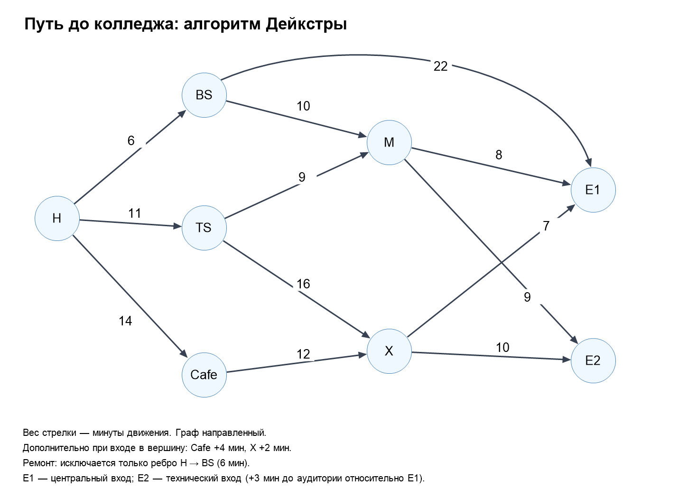

# Путь до колледжа

### Алгоритм Дейкстры · Практическая работа для 3П3

**Дисциплина:** Алгоритмы и структуры данных  
**Язык:** C# · .NET Framework 4.8

## Задание

Транспортная сеть — ориентированный взвешенный граф. Нужно найти кратчайший
по времени путь от дома **H** до центрального входа в колледж **E1**.
Затем удалить выбранную дорогу и автоматически пересчитать маршрут.
Исходные вершины и все 12 рёбер взяты из файла «Алгоритм Дейкстры.docx».

## Запуск

1. Распакуйте архив.
2. Откройте `CollegeRoute.csproj` в Visual Studio с инструментами разработки .NET Framework 4.8.
3. Соберите и запустите программу сочетанием **Ctrl+F5**.
4. Выберите **3** и введите номер дороги из показанного списка. Введите **0**, чтобы отменить удаление.

Номера оставшихся дорог сохраняются. Можно последовательно удалить несколько
дорог. При перезапуске восстанавливается исходный граф.

## Схема графа

Числа у стрелок — время движения. Задержки Cafe +4 и X +2 указаны отдельно:
они добавляются при входе в вершину, а не включены в исходные подписи рёбер.
Редактируемая векторная версия находится в `graph.svg`.

## Файлы

| Файл | Назначение |
| :--- | :--- |
| Program.cs | Консольное меню, вывод маршрутов и сравнение сценариев |
| Graph.cs | Списки смежности, вершины, задержки и ориентированные рёбра |
| Dijkstra.cs | Дейкстра, расстояния и восстановление пути |
| RouteModel.cs | Все исходные вершины и рёбра задания |
| CollegeRoute.csproj | Проект Visual Studio |
| graph.png / graph.svg | Схема графа |

## Обозначения

| Вершина | Значение | Дополнительное время |
| :---: | :--- | :--- |
| H | Дом | 0 |
| BS | Автобусная остановка | 0 |
| TS | Трамвайная остановка | 0 |
| Cafe | Кофейня | 4 минуты при входе |
| M | Метро | 0 |
| X | Пешеходный переход | 2 минуты при входе |
| E1 | Центральный вход | Цель задачи |
| E2 | Технический вход | Ещё +3 минуты относительно пути от E1 до аудитории |

Время от E1 до аудитории в задании не указано. При сравнении входов его
можно принять за общий нулевой базовый уровень: E2 получает поправку +3.
Эта поправка не добавляется к расстоянию **до самого E2**.

## Меню

| Пункт | Действие |
| :---: | :--- |
| 1 | Кратчайший путь H → E1 в текущем состоянии |
| 2 | Сравнить исходную сеть и сценарий с закрытой H → BS |
| 3 | Удалить любую дорогу по номеру и пересчитать путь |
| 4 | Показать расстояния от H до всех вершин |
| 5 | Показать дороги текущего графа с номерами |
| 0 | Выход |

## Результат

| Сценарий | Оптимальный маршрут | Время |
| :--- | :--- | :---: |
| Все дороги открыты | H → BS → M → E1 | 6 + 10 + 8 = **24 мин** |
| Дорога H → BS закрыта | H → TS → M → E1 | 11 + 9 + 8 = **28 мин** |

После закрытия маршрута к автобусу оптимальный путь проходит через трамвай
и метро. Общее время увеличивается на **4 минуты**.

| Вершина | До закрытия | После закрытия |
| :---: | :---: | :---: |
| H | 0 | 0 |
| BS | 6 | Недостижима |
| TS | 11 | 11 |
| Cafe | 18 | 18 |
| M | 16 | 20 |
| X | 29 | 29 |
| E1 | 24 | 28 |
| E2 | 25 | 29 |

Например, H → Cafe → X → E1 занимает 14 + 4 + 12 + 2 + 7 = **39 минут**.
Закрытая дорога не участвует в списке смежности. Это эквивалентно бесконечному
весу и позволяет не выполнять арифметику с бесконечностью.

## Как работает алгоритм

1. Для H задаётся расстояние 0, для остальных — `long.MaxValue`.
2. Перебором выбирается непосещённая вершина с наименьшим расстоянием.
3. Для каждого исходящего ребра выполняется релаксация:
   `candidate = distance[current] + edge.Minutes + delay[next]`.
4. Если результат меньше прежнего, обновляются расстояние и предшественник.
5. Выбор повторяется, пока есть достижимые непосещённые вершины.
6. Путь восстанавливается по предшественникам и переворачивается через `Reverse()`.

Вес движения и задержки неотрицательны, поэтому Дейкстра применим.
Программа поддерживает нулевые веса, но отрицательные значения отклоняет.
Граф направленный: наличие H → BS не означает наличия BS → H.

## Сложность — O-большое

V — число вершин, E — число ориентированных рёбер.
Ближайшая вершина выбирается простым перебором:

- До V выборов, каждый занимает O(V): **O(V²)**.
- Все исходящие рёбра суммарно просматриваются за **O(E)**.
- Итого: **O(V² + E)** времени.
- Дополнительная память алгоритма: **O(V)**.
- Хранение графа: **O(V + E)**.
- Восстановление одного пути: **O(V)**.

Словари и HashSet оцениваются в среднем при ограниченной длине ID.
Сравнение двух сценариев вызывает алгоритм постоянное число раз и не меняет асимптотику.
Очередь с приоритетом в этой учебной реализации не используется.

## Кратко для защиты

«Я представил сеть ориентированным взвешенным графом со списками смежности.
Дейкстра последовательно выбирает ближайшую непосещённую вершину и обновляет
расстояния до её соседей. Например, при удалении H → BS я исключаю ребро и запускаю
алгоритм заново. Маршрут меняется с автобусного на трамвайный, время растёт
с 24 до 28 минут. Сложность моей реализации — O(V² + E)».
